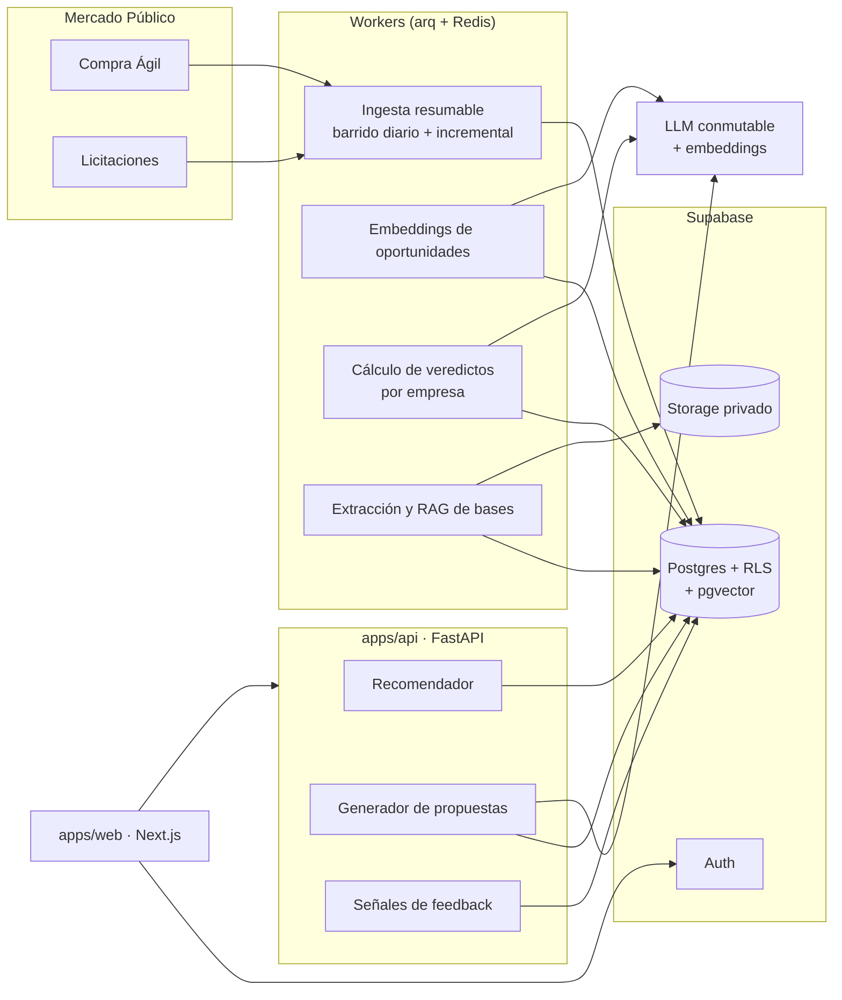

# PropAgent

Discovery de oportunidades y **generación de propuestas con loop de aprendizaje** para empresas que
postulan a Mercado Público (ChileCompra). Es un producto propio, en desarrollo, enfocado en los sectores
**TI y Consultoría**.

> Este repositorio es una vitrina: muestra el problema, la arquitectura y las decisiones técnicas. No
> contiene código fuente, prompts, datos de clientes ni la lógica detallada del recomendador.

## El problema

Una empresa que vende al Estado tiene que revisar a diario miles de compras ágiles y licitaciones
abiertas para encontrar las pocas que le calzan. Ese filtro se hace a mano, con búsquedas por palabra
clave que dejan pasar oportunidades buenas y llenan la bandeja de ruido. Cuando por fin aparece una que
sirve, preparar la oferta (leer las bases, armar la propuesta técnica y la económica, cumplir el formato)
consume días que muchas veces no hay antes del cierre.

El resultado: **se pierden oportunidades por no verlas a tiempo y se pierde tiempo preparando propuestas
desde cero**.

## Qué hace PropAgent

```text
APIs de Mercado Público ──► ingesta diaria ──► oportunidades normalizadas
                                                     │
perfil de la empresa ──► perfil de demanda ──► recall por unión de canales ──► ranking ──► veredicto
                                                                                              │
              ┌──────────────────────────────┬────────────────────────────────┬──────────────┘
              ▼                              ▼                                ▼
         Recomendadas                   Para revisar                     Descartadas (con motivo)
              │
              ▼
   bases / TDR ──► RAG ──► propuesta técnica y económica ──► edición y exportación
              ▲
   señales del usuario (interesa / no interesa / guardar / descartar) ──► ajustan el feed
```

- **Discovery consolidado.** Compras ágiles y licitaciones en un solo feed, ordenado por un ranking único
  y separado en tres veredictos: **Recomendadas**, **Para revisar** y **Descartadas**.
- **Transparencia en el descarte.** Nada desaparece en silencio: cada oportunidad descartada muestra por
  qué (una regla de contenido o un filtro de región o monto) y el usuario puede rescatarla o aflojar la
  regla.
- **Generación de propuestas.** A partir de las bases o el TDR de la oportunidad y del perfil de la
  empresa, genera la oferta técnica y la económica, versionadas y exportables a PDF o Word.
- **Loop de aprendizaje.** Las señales del usuario (guardar, descartar, "me interesa", "no me interesa")
  se aplican sobre el veredicto del modelo y alimentan las siguientes recomendaciones.
- **Multiempresa desde el inicio.** Cada empresa es un tenant aislado, con equipo, roles e invitaciones.

## Alcance

| Cubre | No cubre (decisión de producto) |
|---|---|
| Compra Ágil | Convenio Marco: precios catalogados y vigencia plurianual son otro dominio operativo |
| Licitaciones públicas, todos los rangos de monto | Trato Directo, Subasta Inversa y Compras Coordinadas: fuera del circuito de licitación estándar |
| Sectores TI y Consultoría | Otros rubros, que se evaluarán después de validar el MVP |

## Arquitectura



- **Monorepo pnpm + Turborepo** con dos aplicaciones: `apps/web` (Next.js) y `apps/api` (FastAPI con
  workers).
- **Una base Postgres compartida** en Supabase, con aislamiento por tenant vía Row Level Security y
  pgvector en la misma instancia para el recall semántico y el RAG.
- **Ingesta desacoplada** del producto: workers programados traen el universo de oportunidades abiertas
  y lo dejan normalizado en un catálogo global, sin tenant.
- **Recomendador por empresa**: los veredictos se precomputan por tenant y el feed los lee ya resueltos.
- **Arquitectura hexagonal**: la capa de aplicación nunca importa el SDK de un proveedor; habla con
  interfaces internas y los adaptadores concretos viven aparte.

El detalle está en [docs/architecture.md](docs/architecture.md).

## Decisiones de diseño

**1. Una tabla wide para las oportunidades, no herencia de tablas.**
Compra Ágil y Licitación comparten la mayoría de los campos, pero cada una tiene los suyos. Se eligió una
sola tabla con un discriminador por modalidad, columnas tipadas con prefijo por dominio y CHECK
constraints que exigen coherencia (una compra ágil no puede traer campos de licitación y viceversa),
en lugar de Class Table Inheritance. Motivo: el recomendador es el camino crítico y lee sin JOINs; el
equipo es chico; y la diferencia de rendimiento entre wide y narrow es irrelevante al volumen actual. La
salida está acotada: si los dominios divergen mucho o aparecen más modalidades, migrar a CTI es un
cambio mecánico. Como contrapartida, la tabla nunca se consulta con `SELECT *`.

**2. El ranking consolidado se calcula en el servidor.**
Mezclar en el frontend los dos feeds por modalidad parece más simple, pero cada uno devuelve un top-N ya
recortado y el merge deja fuera oportunidades que en el ranking global quedarían arriba. El feed
consolidado compara los scores de ambos dominios juntos y la modalidad queda como filtro secundario.

**3. Recall por unión de canales antes del ranking.**
Ningún canal por sí solo encuentra todo: la clasificación UNSPSC falla cuando el comprador codifica mal,
las palabras clave fallan con sinónimos y los embeddings fallan con textos muy cortos. Primero se arma el
conjunto candidato como unión de varios canales (categorías, palabras clave del sector, líneas de oferta
del perfil) y recién después se re-ordena y se emite el veredicto. Cada candidato registra por qué canal
entró, lo que permite auditar el recall.

**4. Veredicto ternario y descarte explicado.**
En vez de un score que el usuario no sabe leer, cada oportunidad recibe un veredicto de tres valores. Los
descartes por regla y por filtro duro se distinguen, para ofrecer el rescate correcto en cada caso.

**5. Ingesta durable y resumable.**
Las APIs de Mercado Público tienen topes por consulta que esconden parte del universo si se consultan de
forma ingenua. El barrido descubre día por día, deduplica y procesa el detalle desde una cola durable en
la base, por lotes. Si el proceso se corta, retoma desde lo pendiente en vez de perder la corrida.

**6. Multi-tenancy como invariante verificada en CI.**
Toda tabla de negocio lleva `tenant_id` con RLS; solo un conjunto explícito de catálogos públicos queda
exento. La CI corre contra Postgres real con un rol sin privilegios de superusuario (que de otro modo se
saltaría RLS) y rechaza modelos sin `tenant_id`, handlers sin sesión de tenant y skills que importen SDKs
de proveedores.

**7. Proveedor de LLM conmutable.**
Generación, clasificación y embeddings pasan por interfaces propias. Eso permite usar un modelo grande para
redactar, uno liviano y por lotes para clasificar, y un endpoint compatible con OpenAI para probar el
pipeline sin gastar créditos del proveedor productivo.

## Stack

| Capa | Tecnología |
|---|---|
| Monorepo | pnpm workspaces · Turborepo |
| Frontend | Next.js 15 · React 19 · TypeScript · Tailwind CSS v4 · shadcn/ui · TanStack Query · Zod · Biome · Playwright |
| Backend | Python 3.12 · FastAPI · SQLAlchemy 2 async · Pydantic v2 · Alembic · uv · Ruff · pytest |
| Datos | Supabase: Postgres con RLS, pgvector, Auth y Storage |
| Workers | arq + Redis |
| IA | Claude (generación y clasificación) · Voyage (embeddings) · adaptador OpenAI-compatible |
| Documentos | Extracción en cascada (texto, layout, OCR) · exportación a PDF y Word |
| Infraestructura | Vercel (web) · Railway (api y workers) · GitHub Actions · Sentry |

## Estado

MVP funcional de punta a punta, en **fase de validación con empresas piloto** de los sectores TI y
Consultoría durante 2026. Lo siguiente es medir con los pilotos la calidad del recomendador y el tiempo
ahorrado por propuesta antes de abrir el producto.

## Por qué no está el código

PropAgent está en desarrollo comercial, así que el código, los prompts, los datos y la lógica del
recomendador no son públicos. Puedo mostrar el repositorio y el producto funcionando en una entrevista
técnica.

## Licencia

Todos los derechos reservados. Ver [LICENSE](LICENSE).

---

**Nicolás González Rojas** · Head of Data & BI · [LinkedIn](https://www.linkedin.com/in/nicolas-gonzalez-rojas)
