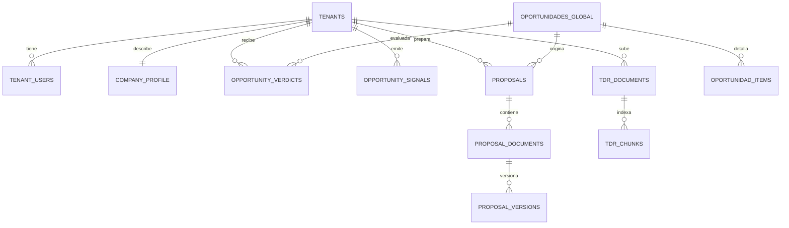

# Arquitectura de PropAgent

Este documento amplía la sección de arquitectura del [README](../README.md). Describe componentes,
flujos y decisiones a nivel de diseño. Deliberadamente no incluye prompts, pesos, umbrales, reglas de
descarte ni la fórmula del scoring.

## 1. Vista general

```text
propagent/
├── apps/
│   ├── web/      Next.js 15 · interfaz de discovery, propuestas, onboarding y administración
│   └── api/      FastAPI · API REST v1 + workers arq
├── infra/        configuración de despliegue (Railway, Supabase)
└── .github/      CI: lint, tipos, tests con Postgres real, guardas de tenancy y e2e
```

Tres procesos en producción:

| Proceso | Responsabilidad | Hosting |
|---|---|---|
| `web` | Interfaz, sesión del usuario (login, recuperación y OAuth directo contra el proveedor de auth) | Vercel |
| `api` | Endpoints REST, autorización por tenant y rol, orquestación de la generación | Railway |
| `worker` | Ingesta, embeddings, veredictos, procesamiento de documentos y tareas programadas | Railway (+ Redis) |

Postgres, Auth, Storage y pgvector viven en una sola instancia de Supabase.

## 2. Capas del backend

```text
api/v1/routes  ──►  skills (aplicación)  ──►  services (interfaces)  ◄──  adapters (proveedores)
     │                                                                          │
     └── schemas (DTOs Pydantic)                    db/models + migraciones + políticas RLS
```

- **routes**: routers FastAPI delgados. Toda ruta que toca la base recibe una sesión ligada al tenant
  actual; nunca una sesión genérica.
- **skills**: la lógica de aplicación, agrupada por capacidad: ingesta, recomendador, documentos de
  licitación, RAG, propuestas, análisis de participación y precios.
- **services**: interfaces abstractas: LLM, embeddings, vector store, extractor de documentos,
  almacenamiento, autenticación, identidad, cliente de marketplace y exportador de propuestas.
- **adapters**: implementaciones concretas (proveedor de LLM, Voyage, pgvector, Supabase, clientes de
  Mercado Público, extractores). Es la única capa que importa SDKs externos; la CI lo verifica.
- **schemas**: DTOs separados de los modelos SQLAlchemy. Los bloques JSONB que consume un motor
  backend también se validan con Pydantic; el JSONB libre queda solo para datos que lee el frontend.

## 3. Modelo de datos



Principios:

1. **Multi-tenancy por RLS.** Toda tabla de negocio tiene `tenant_id NOT NULL`, índice y políticas para
   los cuatro verbos. La sesión fija el tenant con una variable de transacción que las políticas leen.
2. **Lista blanca explícita.** Solo los catálogos públicos y la metadata operativa (oportunidades,
   ítems, taxonomía UNSPSC, corridas y cola de ingesta, catálogos de sector, telemetría de uso de LLM)
   quedan sin `tenant_id`. Una excepción nueva exige una decisión documentada.
3. **Append-only donde importa.** Las versiones de propuesta solo admiten INSERT y SELECT: el historial
   de cada generación (entrada, modelo, tokens, costo y salida) no se puede editar.
4. **Upsert idempotente.** Los datos externos se identifican por una clave natural (código + modalidad),
   así que el barrido general y el incremental convergen sin duplicar.
5. **Payload original conservado** en JSONB para reprocesar sin volver a llamar a la fuente.
6. **Datos sensibles cifrados en la aplicación**, con la llave fuera de la base y del repositorio.

### Oportunidades: una tabla wide

`oportunidades_global` guarda compras ágiles y licitaciones en una sola tabla:

- un discriminador `marketplace`;
- columnas comunes (código, comprador, montos, fechas, estado, región, texto);
- columnas propias de cada dominio con prefijo (`ca_*`, `lic_*`);
- CHECK constraints que impiden mezclar campos de un dominio en una fila del otro;
- un índice parcial para las oportunidades activas que lee el recomendador;
- búsqueda de texto completo y una columna de embedding en la misma fila.

Se descartó Class Table Inheritance porque obliga a un JOIN en el camino crítico del recomendador y
agrega superficie de migraciones sin beneficio al volumen actual. Para consumidores por dominio (BI,
exportaciones) hay vistas SQL que exponen solo las columnas de cada modalidad.

## 4. Ingesta

```text
           ┌───────────── barrido general (madrugada, por modalidad) ─────────────┐
           │  descubrimiento día por día ──► cola durable ──► detalle por lotes   │
           │                                    ▲                   │            │
           │                     retoma lo pendiente           upsert idempotente│
           └──────────────────────────────────────────────────────────────────────┘
           ┌───────────── incremental (varias veces al día) ──────────────────────┐
           │  publicadas hoy ──► descarta códigos ya conocidos ──► detalle nuevo  │
           └──────────────────────────────────────────────────────────────────────┘
                                         │
                                         ▼
                          embeddings ──► veredictos por tenant
```

- **Descubrimiento día por día.** Las APIs públicas tienen topes por consulta y filtros de estado que
  no devuelven el universo abierto completo. Se recorre la ventana de días, se filtra lo publicado con
  cierre futuro y se deduplica por código.
- **Cola durable.** El descubrimiento es barato; el detalle es caro. Cada código pendiente es una fila en
  una cola en Postgres, que se drena por lotes con commit por lote. Las invocaciones concurrentes toman
  lotes disjuntos (`FOR UPDATE SKIP LOCKED`), el worker se re-encola antes de su timeout y al arrancar
  retoma las corridas huérfanas.
- **Tolerancia a filas malas.** Cada upsert va en un SAVEPOINT: una fila inválida no revierte el lote.
- **Zona horaria explícita.** Los crons y las ventanas de fecha se evalúan en hora de Chile, no en la del
  contenedor.
- **Resiliencia.** Reintentos con backoff ante límites de tasa, concurrencia acotada en el detalle,
  monitoreo proactivo de credenciales y un interruptor para apagar una fuente sin redeploy.
- **Redacción de secretos en logs.** Un procesador de logging enmascara credenciales y tokens.

## 5. Recomendador

El recomendador es un embudo de cuatro etapas, no un ranking estático:

| Etapa | Qué hace |
|---|---|
| Perfil de demanda | Al terminar el onboarding se deriva un perfil estructurado de la empresa: líneas de oferta, cobertura geográfica y rangos de monto. |
| Recall por unión | El conjunto candidato es la unión de varios canales: categorías UNSPSC, palabras clave del sector y líneas de oferta, con re-orden semántico por embeddings. Cada candidato registra su canal de entrada. |
| Veredicto | Un worker precomputa por tenant un veredicto de tres valores para cada oportunidad, atado a la versión vigente del perfil de demanda. Si el perfil cambia, los veredictos se recalculan. Los filtros duros y las reglas de contenido alimentan la vista de descartadas con su motivo. |
| Feedback | Las señales del usuario se guardan append-only y se derivan a un estado (guardada, descartada, promovida, rechazada, rescatada) que se aplica sobre el veredicto. |

Endpoints de discovery (todos `GET`):

- feed por modalidad (compra ágil, licitación) y **feed consolidado**, cada uno por pestaña de veredicto;
- **descartadas**, con el motivo estructurado y su origen (regla o filtro duro);
- **candidatos**, una superficie de observabilidad para inspeccionar el recall por canal.

El feed consolidado se rankea en el servidor: comparar scores de ambos dominios en un solo ordenamiento
es la única forma de que el top global sea correcto. Si un tenant todavía no tiene veredictos, el feed
cae a las oportunidades activas ordenadas por score, sin regresión.

La clasificación masiva usa un modelo liviano a través de una API de lotes, lo que reduce el costo por
oportunidad evaluada.

## 6. Documentos y RAG

```text
bases / TDR ──► extractor en cascada ──► secciones ──► clasificador de secciones ──► chunker
                (texto → layout → OCR → multimodal)        (descarta lo administrativo)     │
                                                                                            ▼
                                     contexto para la propuesta ◄── re-rank ◄── pgvector (HNSW)
```

- **Extracción en cascada**: se intenta primero el método más barato y solo se escala cuando falla. Los
  binarios no se envían al LLM por defecto.
- **Pre-procesamiento**: un clasificador descarta secciones administrativas y anexos estándar antes de
  vectorizar, lo que reduce costo y ruido en el contexto.
- **Chunking dentro de cada sección**, con solapamiento, y fusión de secciones muy cortas.
- **Vector store en pgvector**, con filtro explícito por tenant además de RLS para aprovechar el índice.
- **Sobre-recuperación y re-rank**: se recuperan más fragmentos de los necesarios y un modelo liviano
  elige los más relevantes; si el re-rank falla, se usa el orden vectorial.
- **Idempotencia**: un documento ya procesado (mismo hash) no se reprocesa.

## 7. Generación de propuestas

1. Se reúnen el perfil de la empresa, la oportunidad y el contexto recuperado de las bases.
2. Se carga una plantilla por sector como bloque cacheado del prompt, para que las llamadas sucesivas del
   editor reutilicen el contexto.
3. El modelo de generación redacta; la salida se parsea a documentos separados (técnica, económica y
   anexos), cada uno con su propia secuencia de versiones.
4. Cada versión guarda un snapshot completo de la entrada, el modelo, los tokens y el costo.
5. El endpoint de generación acepta una llave de idempotencia para no duplicar trabajo caro.
6. La propuesta se edita en la interfaz y se exporta a PDF o Word con la identidad de la empresa.

## 8. Autenticación y equipos

- Registro atómico en el backend: crea el usuario en el proveedor de identidad, el tenant, la membresía y
  el perfil; si la base falla, revierte el usuario creado.
- Login, recuperación y OAuth van directo del frontend al proveedor de auth; el backend solo valida el JWT.
- Varios usuarios por empresa, con roles (owner, editor, viewer, billing), invitaciones por enlace y
  autorización por rol en el backend.
- Archivos de cada tenant en un bucket privado; el prefijo del tenant se fuerza en el servidor y la
  descarga usa URLs firmadas de corta duración.

## 9. Calidad y operación

- **CI** en cada cambio: Ruff y pytest contra Postgres con pgvector y un rol de aplicación sin privilegios
  de superusuario; guardas de tenancy; lint y typecheck del frontend; pruebas e2e con Playwright.
- **Migraciones** versionadas con Alembic; las políticas RLS viven junto al modelo.
- **Observabilidad**: Sentry en API y workers, logs estructurados y un registro de consumo de LLM por
  operación, visible en un panel de administración junto al estado de la ingesta.
- **Smoke tests** manuales contra staging antes de tocar tenancy o RLS.

## 10. Lo que este documento no incluye

- Prompts, plantillas de propuesta y ejemplos de salida.
- Pesos, umbrales, reglas de descarte y catálogos de palabras clave.
- Datos de empresas, de pilotos o de oportunidades reales.
- Detalles operativos de credenciales y acceso a las fuentes.

---

**Nicolás González Rojas** · Head of Data & BI · [LinkedIn](https://www.linkedin.com/in/nicolas-gonzalez-rojas)
